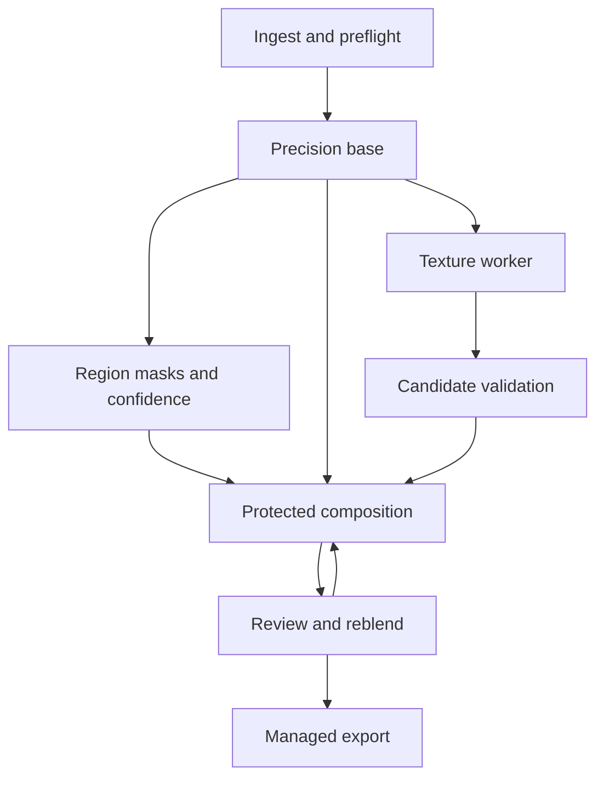

# Architecture blueprint and implementation map

Snapshot: Studio code `5f32fba` in PR #12. Paths below describe that branch until it
merges. `main` retains the earlier native/pipeline code; documentation presence
alone does not change runtime availability.

## Target data flow

The implemented regional path receives an already aligned base/texture pair.
Target automatic ingest/precision/generation/segmentation is not fully connected.
The native CLI remains a separate, preserved lane rather than a hidden replacement.

## Current modules and owners by responsibility

| Area | Modules/entry points | Current capability | Boundary |
| --- | --- | --- | --- |
| Native runtime | `bin/fidelis`, `scripts/install-*`, candidate catalog | NCNN/Vulkan registration and auditions | Weight/device evidence required |
| Existing pipeline | `fidelis/core/`, `fidelis/modules/` | Legacy orchestration, profiling, optional restoration | Known audit defects; not the Studio source of truth |
| Tiling | `fidelis/engine/tiler.py`, `streaming.py` | Tested overlap and row-streamed fusion | No guarantee of model visual fidelity |
| Composition | `fidelis/postprocess/regions.py` | Linear-light sRGB blend, confidence and exact locks | uint8 RGB input, explicit masks |
| ROI & drift guard | `fidelis/postprocess/roi_protection.py`, `scripts/screen-roi-drift.py` | Explicit ROI locks, bounded Sobel heuristic, local shift & lock screening | Explicit ROIs (`corpus_manifest.py`), matching dimensions |
| Masks | `fidelis/studio/brush.py`, `editor.js` | Native stripe raster and browser parity | Manual masks; not automatic semantics |
| Persistence | `fidelis/studio/store.py` | SQLite manifests, immutable NPYs, revisions, budgets | Synchronous, single-user; not total-RSS certification |
| HTTP/UI | `scripts/web-ui.py`, `fidelis/studio/http.py`, `studio.html` | Local review/edit/save/export | Visual/device acceptance pending |
| Background generation | `fidelis/studio/generation.py`, optional server workflow | Durable bounded worker, scoped local cancel and same-run resume | Protocol-tested; no global GPU cancel; aggregate cache quota pending |
| Texture bridge | `fidelis/studio/comfy.py`, `scripts/generate-texture.py` | Graph schema preflight, run ledger and polling | Fixture/protocol tested; no certified model graph |
| Capabilities | `capabilities.py`, `scripts/backend-doctor.py` | Installed/checksummed versus declared | Availability is not quality certification |
| Evaluation | `fidelis/eval/`, experiments and scripts | Existing metrics/corpus tooling | Frozen production corpus/true perceptual evidence pending |

## Persisted and API contracts

- Images: aligned HxWx3 uint8 RGB, explicitly normalized untagged sRGB in the current
  path. EXIF rotation, ICC/alpha and true high-precision ingest require later work.
- Masks: float32 HxW values in [0,1]; skin, hair, fabric, protected, confidence and
  optional edge guard. Missing class/confidence does not imply permission to invent.
- Artifact descriptor: relative path, SHA-256, shape, dtype, encoding and byte count.
- Job manifest v1: ID, revision, dimensions, profile/blend, artifacts, timestamps,
  candidate recipe and unsigned provenance. SQL commit controls visible revision.
- Brush edit: normalized points, layer/mode, radius, hardness and opacity. Native
  rasterization preserves untouched source masks; undo history is unsaved-session state.
- Backend run: source/graph recipe identity, prompt ID, state, output checksum and
  actual workflow. Graph hash alone does not verify checkpoint bytes.

Explicit protection is applied after colour transfer/quantization. No global
finishing step may alter fully locked pixels without restoring that invariant.
Equal image shape is necessary but not sufficient for internal geometric alignment.

## Storage and failure semantics

SQLite serializes artifact-manifest commits. Candidate revisions use unique files;
old referenced data survives failed edits. Unreferenced arrays are cleaned at the
next write/startup. Checksum mismatch fails before render/export. Storage limits
include staging headroom; SQLite journal/database overhead is separate.

Composition works in stripes; full PNG export streams scanlines. Upload decoding,
Python allocations, mapped pages and codecs remain outside the stripe allowance.
Power-loss recovery and corruption repair are not certified. Do not silently
change schemas or delete saved data to solve a budget failure.

The Comfy bridge reserves a run before submission, keeps prompt IDs, resumes
polling and reconciles uncertain submissions. It does not automatically submit
again after an ambiguous outcome. It uses trusted, locally exported API graphs;
there is no universal SDXL-to-FLUX node substitution or automatic cloud failover.

## Interfaces for parallel changes

- Preserve the image/mask/revision contracts while UI and worker work proceed.
- Keep backend integration outside composition; inference returns a candidate
  rather than mutating protected pixels or user masks.
- Keep model promotion/evidence outside availability scanning.
- Version storage/API changes and coordinate their migration before merging.
- Do not add an orchestration service, framework migration or public deployment
  as an incidental fix. Document a decision and test the changed boundary first.

See [Risks](RISKS.md) for inherited pipeline defects and [Decisions](DECISIONS.md)
for the current tradeoffs. The detailed technical plan remains in
[FIDELIS_STUDIO_PLAN.md](../FIDELIS_STUDIO_PLAN.md).

Current F07-A queue and crash/cancellation contracts: [Background generation](../ASYNC_GENERATION.md).

Native read-only crop endpoint and paired inspector: [Inspection contract](../NATIVE_INSPECTION.md). Crops are revision-pinned, bounded to 512 px per side and never resampled by the server.

The explicit [benchmark inventory](../BENCHMARK_CORPUS.md) is separate from legacy
corpus discovery/synthetic generation; only validated reviewed production records
can enter an unsigned benchmark lock.

Imported [mask suggestions](../MASK_SUGGESTIONS.md) use optional `suggestion_*`
artifacts and `mask_suggestion` review metadata in the existing manifest. Stage
advances revision without changing active masks/master; accept performs a striped
fill-only-unclassified merge. Model inference is a separate unqualified boundary.

Structural [ROI protection and internal drift screening](../ROI_DRIFT_SCREENING.md)
translates declared ROI rectangles and explicit `override` choices into exact
`protected` locks, bounded secondary Sobel `edge_guard` attenuation
(`sobel_is_semantic_proof=False`), and equal-dimension local shift/coherence
screens (`F10` partial groundwork; live F06 candidates and F12 corpus gates remain open).
